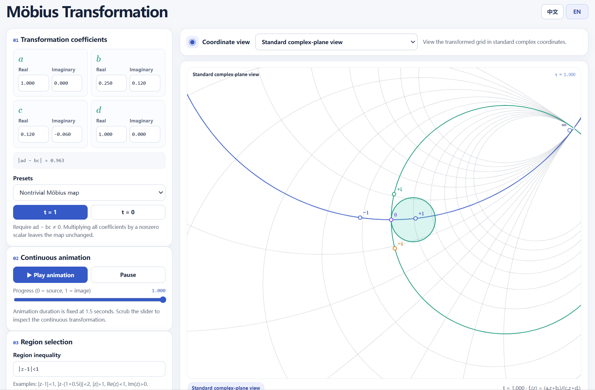

# Möbius Transformation Visualizer

An interactive playground for exploring Möbius transformations and their geometric effects on the complex plane.

The goal is to make these transformations easier to understand through visual experiments and continuous animations.

Built with the help of ChatGPT.

🌐 **[Try it here](https://tojyc.github.io/Mobius_transformation_visualizer/)**

## Exploring Möbius Transformations

A Möbius transformation has the form

\[
f(z)=\frac{az+b}{cz+d},
\qquad ad-bc\neq 0.
\]

Instead of just calculating the image of individual points, this visualizer lets you see how the coordinate grid and selected regions change under a transformation.

You can experiment with different coefficients, or start with presets such as rotations, translations, inversion, and the identity map.

## Animation

Use `t=0` and `t=1` to switch between the initial and target configurations.

Play the animation or move the progress slider to observe the transformation continuously. This makes it easier to explore how the geometry changes between the two states.

You can also select regions using inequalities, switch between the standard complex-plane and Cayley views, and adjust the display options.

## Preview

